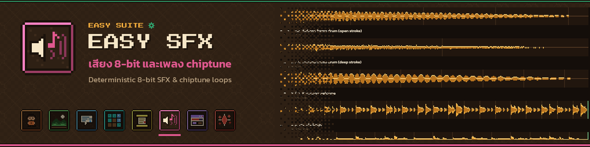
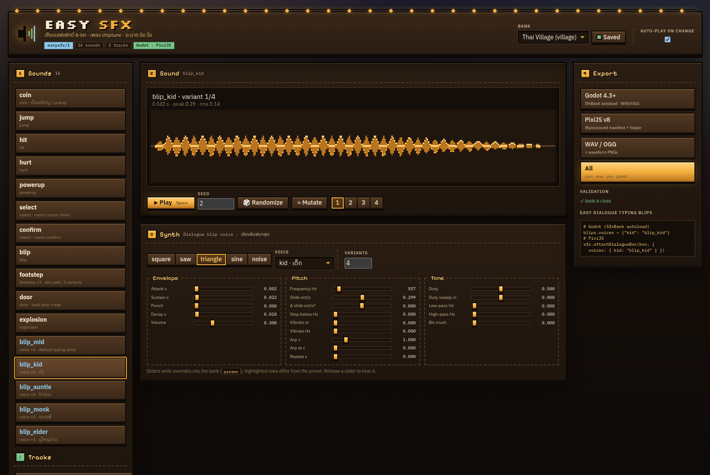
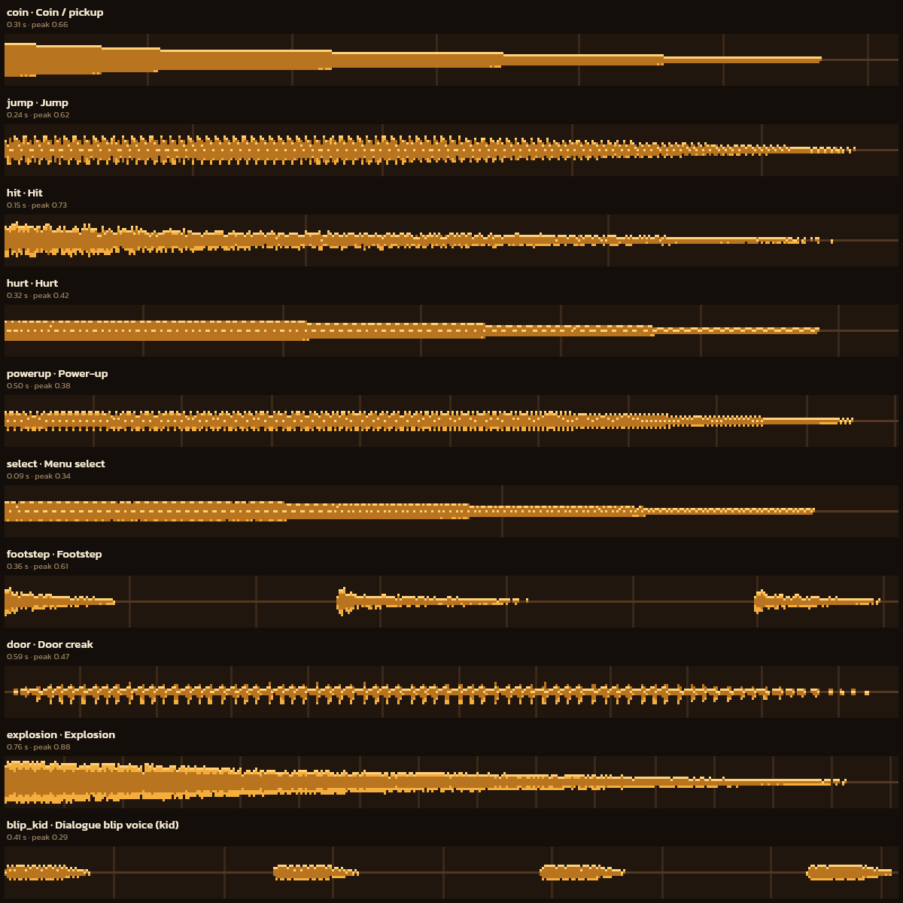
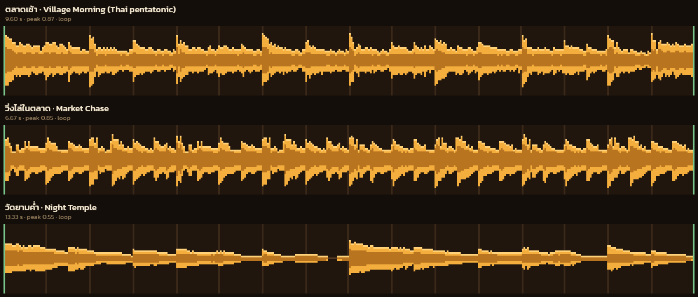
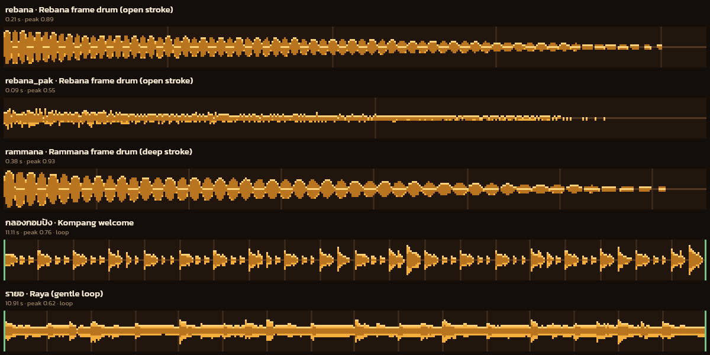
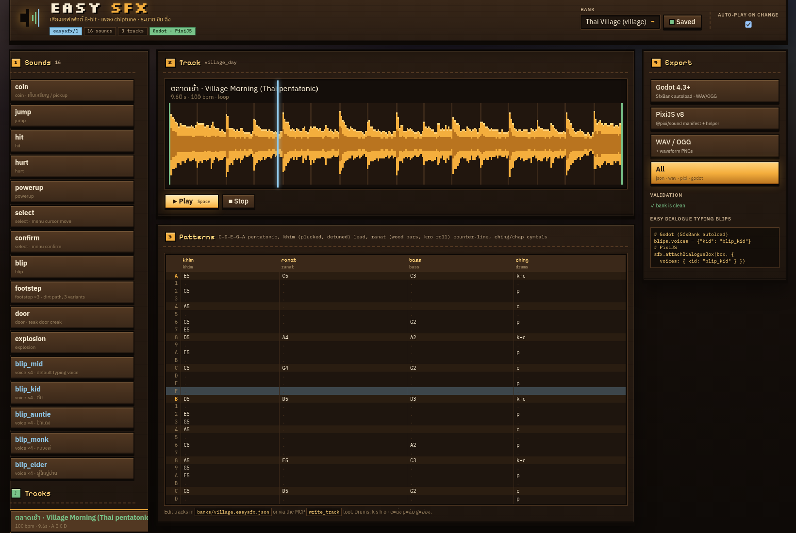

<!-- easy-suite:header:start -->
<p align="center">
  <a href="#easy-suite"></a>
</p>

<p align="center">
  <b>Easy SFX</b> · เสียง 8-bit และเพลง chiptune · Deterministic 8-bit SFX & chiptune loops<br />
  <sub>Part of <a href="#easy-suite"><b>Easy Suite</b></a>: Thai-friendly pixel-art game dev tools for Godot 4.3+ and PixiJS v8</sub>
</p>

<p align="center">
  <a href="https://github.com/Saladin2020/easysfx/actions/workflows/ci.yml"></a> <a href="LICENSE"></a>  <a href="#export"></a> <a href="docs/MCP.md"></a> 
</p>

<p align="center">
  <a href="https://github.com/Saladin2020/easysprite"></a>
  <a href="https://github.com/Saladin2020/easyscene"></a>
  <a href="https://github.com/Saladin2020/easydialogue"></a>
  <a href="https://github.com/Saladin2020/easytilemap"></a>
  <a href="https://github.com/Saladin2020/easyquest"></a>
  <a href="https://github.com/Saladin2020/easysfx"></a>
  <a href="https://github.com/Saladin2020/easyui"></a>
  <a href="https://github.com/Saladin2020/easyfx"></a>
</p>
<!-- easy-suite:header:end -->

# Easy SFX

**เสียงเอฟเฟกต์ 8-bit · เพลง chiptune · ขิม ระนาด ฉิ่ง**  
Make retro sound effects and short 4-channel chiptune loops **from code** — sfxr-style presets with seeds,
a tiny tracker format, deterministic WAV render — and export them to **Godot 4.3+** (an `SfxBank` autoload)
and **PixiJS v8** (`@pixi/sound`-ready manifest). Includes typing-blip voices that plug straight into
[Easy Dialogue](https://github.com/Saladin2020/easydialogue). A sibling of
[Easy Sprite](https://github.com/Saladin2020/easysprite) and [Easy Scene](https://github.com/Saladin2020/easyscene).

[](https://nodejs.org)

> Easy SFX **synthesizes · renders · exports**. No samples, no AI generation, no paid APIs: every sound is
> math + a seed, so the same bank always produces byte-identical WAVs (the tests check the hashes).

<p align="center">
  
</p>

---

## What you get

| Sounds | Music | Dialogue | Export |
| --- | --- | --- | --- |
| 13 presets — coin, jump, hit, hurt, powerup, select, blip, footstep, door, explosion, **rebana** (รือบานา), **rammana** (รำมะนา), **voice** — each a seeded generator; override any of 20 parameters; variants; mutate | `easysfx/1` tracker: 4 channels, text patterns (`C5 . E5 -`), order list, square/saw/triangle/sine/noise, **pluck** (khim), additive **partials** (ranat, bells), ching/chap/gong drums, rebana / kompang (bung, pak) and rammana frame drums, seamless loops | 8 typing-blip voices (`mid low high kid elder monk auntie robot`) × variants; hooks for Easy Dialogue's `DialogueBox` in Godot **and** Pixi | Godot 4.3+ project (`SfxBank` autoload, AudioStreamWAV + AudioStreamOggVorbis, `dialogue_blips.gd`), PixiJS v8 Assets manifest + `SfxBank` helper, WAV/OGG + waveform PNGs, JSON |

The demo bank `village` has 19 sounds (5 dialogue voices, 3 frame drums) and 5 loops:

| Track | Feel |
| --- | --- |
| `village_day` · ตลาดเช้า | C–D–E–G–A pentatonic, plucked detuned **khim** lead, **ranat** counter-line with a *kro* roll, triangle bass, **ching/chap** cymbals |
| `market_chase` · วิ่งไล่ในตลาด | A-minor chiptune: 25 % square lead, 12.5 % arpeggio, triangle bass, noise kit, 144 bpm |
| `night_temple` · วัดยามค่ำ | slow detuned triangle pads, bell partials, a small gong |
| `kompang` · กลองกอมปัง | three interlocking kompang parts (bung `b`, pak `t`), the welcome rhythm of Malay weddings and Hari Raya |
| `raya_loop` · รายอ | gentle G-major Hari Raya loop: plucked gambus-style lead, soft accordion chords, triangle bass, quiet rebana |

<p align="center">
  
  
</p>

**Multicultural village · หมู่บ้านพหุวัฒนธรรม**: the Easy Suite samples share one southern Thai town where
Buddhist, Muslim and Chinese-Thai neighbours live side by side. Alongside the Thai khim, ranat and ching, the
bank now has the frame drums of the Malay-Muslim south and the Thai rammana: `rebana` / `rebana_pak` (open
bung and slap pak), `rammana` (deep), the `kompang` welcome rhythm and the gentle `raya_loop`, which Easy
Quest's `ramadan_raya` questline plays with `@sfx raya_loop`. These are instrument and festive sounds only.
Easy SFX does not synthesise the adhan (call to prayer) or any Quran recitation, and none of the melodies
imitate them.

<p align="center">
  
</p>

## Quick start

```bash
npm install
npx tsx src/cli.ts init --workspace ./my-sfx       # banks/village.easysfx.json
npx tsx src/cli.ts serve --workspace ./my-sfx      # editor → http://127.0.0.1:8828/
```

Dev mode: `npm run dev` (API on 8828) + `npx vite --config web/vite.config.ts` (UI on 5178).

The editor plays everything in the browser with the same synth code as the CLI: pick a sound, drag sliders
(release to hear it), 🎲 new seed, ≈ mutate, variants, wave and voice pickers, waveform view; tracks show
their patterns with a play cursor. `Space` plays, `Ctrl+S` saves the bank.

<p align="center">
  
</p>

## CLI

```bash
easysfx list --bank village                     # sounds + tracks
easysfx render coin --out coin.wav --waveform coin.png
easysfx render village_day --out day.ogg --loops 2      # .wav | .ogg | .mp3 (ogg/mp3 need ffmpeg)
easysfx render blip_kid --variant 2 --out blip.wav
easysfx add laser --preset hit --seed 12 --mutate 0.2   # bake a new sound into the bank
easysfx check village                           # JSON-path errors; exit 1 on errors
easysfx export --preset all                     # godot | pixi | wav | json | all  (--no-ogg)
easysfx presets · info · waveform <ref> --out x.png · serve [--port 8828]
```

(`npx tsx src/cli.ts …` from a checkout, `node dist/cli.js …` after `npm run build`.)

## Bank format

```json
{
  "format": "easysfx/1",
  "name": "Thai Village",
  "sounds": {
    "coin": { "preset": "coin", "seed": 3 },
    "laser": { "preset": "hit", "seed": 4, "params": { "wave": "square", "freq": 1400 } },
    "blip_kid": { "preset": "voice", "voice": "kid", "seed": 2, "variants": 4 }
  },
  "tracks": {
    "jingle": {
      "bpm": 120, "steps": 4, "loop": false,
      "channels": [{ "name": "lead", "instrument": "sq" }, { "name": "drums", "instrument": "drums" }],
      "instruments": { "sq": { "wave": "square", "duty": 0.25, "attack": 0, "decay": 0.1, "sustain": 0.5, "release": 0.1, "volume": 0.5 } },
      "patterns": { "A": ["C5 E5 G5 C6 . . . -", "k+c . h . s . p ."] },
      "order": ["A"]
    }
  }
}
```

Full reference: **[docs/FORMAT.md](docs/FORMAT.md)** (all 20 synth parameters, instruments, drum tokens, loops).

## Export

| Preset | Output (`exports/<bank>-<preset>/`) |
| --- | --- |
| `godot` | Godot 4.3+ project: `addons/easysfx/sfx_bank.gd` (autoload `SfxBank`), `dialogue_blips.gd`, `sfx/*.wav` (AudioStreamWAV), `music/*.ogg` (AudioStreamOggVorbis, looped; `.wav` with a loop point without ffmpeg), `easysfx/bank.sfxbank.json`, demo `main.tscn`, `test_bank.gd` |
| `pixi` | `easysfx.manifest.json` — a PixiJS **Assets manifest** (bundles `sfx`, `music`, `[ogg, wav]` sources) plus variant/loop metadata — `easysfx-pixi.js` (`SfxBank`), audio files and a demo `index.html` |
| `wav` | every clip and track as `.wav` (+ `.ogg`), `waveforms/*.png`, `index.csv` |
| `json` | the bank |

**Godot 4.3+**

```gdscript
SfxBank.play("coin")                  # random variant when there are several
SfxBank.play("footstep", -6.0, 1.1)   # volume dB, pitch
SfxBank.play_music("village_day")     # cross-fade, loops
SfxBank.stop_music()
```

**PixiJS v8**

```js
import { SfxBank } from "./easysfx-pixi.js";
const bank = await SfxBank.load("./easysfx.manifest.json", { sound: PIXI.sound }); // @pixi/sound optional (Web Audio fallback)
bank.play("coin");
bank.playMusic("village_day");
```

## Typing blips for Easy Dialogue

No change to Easy Dialogue is needed: the hooks watch the dialogue box's typewriter and play a blip on every
2nd revealed grapheme cluster (Thai clusters like `ที่` count once), skipping spaces and punctuation.

```gdscript
# Godot: a Node with addons/easysfx/dialogue_blips.gd next to your DialogueBox
$Blips.dialogue_box = $DialogueBox.get_path()
$Blips.voices = {"kid": "blip_kid", "vendor": "blip_auntie", "monk": "blip_monk"}   # character id or name → sound
```

```js
// PixiJS: after creating Easy Dialogue's DialogueBox
const sfx = await SfxBank.load("./easysfx.manifest.json");
sfx.attachDialogueBox(box, { voices: { kid: "blip_kid", vendor: "blip_auntie" }, every: 2 });
```

Options: `default_voice` / `defaultVoice` (`blip_mid`), `narration` (blip on lines without a speaker), `every`,
volume. Both were checked against the real `village_delivery` export (Godot headless and headless Chrome).

## MCP

`npm run mcp` (stdio) or `npm run mcp:http` (`http://127.0.0.1:8829/mcp`). Tools: `workspace_info`,
`list_sounds`, `get_sound`, `write_sound`, `write_track`, `render_audio`, `export_bank`.
See **[docs/MCP.md](docs/MCP.md)**.

## Security

The server binds to `127.0.0.1` by default and rejects cross-origin writes and non-loopback `Host` headers.
`--host 0.0.0.0` requires the token printed at startup (or `EASYSFX_TOKEN`). API and MCP paths stay inside
the workspace plus `EASYSFX_ALLOWED_DIRS`.

## Development

```bash
npm run typecheck && npm test && npm run build && npm run smoke
UPDATE_GOLDEN=1 npx vitest run test/synth.test.ts            # after an intended synth change
GODOT=/path/to/godot npx vitest run test/godot.test.ts       # import the export, load every stream
npm run docs:images                                          # README waveforms
python3 scripts/check-pixi.py exports/village-pixi           # headless Chrome: decode + play every sound
python3 scripts/capture-ui.py                                # editor screenshots (server on :8828)
```

Ports: API / editor 8828 · MCP HTTP 8829 · Vite 5178.

<!-- easy-suite:table:start -->
## Easy Suite


Eight small, local-first tools that share one look (teak, lantern gold, Kanit, 16/48px pixels), one
workflow (CLI · web editor · MCP server) and the same targets (**Godot 4.3+** and **PixiJS v8**).
ชุดเครื่องมือทำเกมพิกเซลสไตล์ไทย ใช้ร่วมกันได้ทั้งชุด  
The samples share one multicultural southern Thai village: Buddhist temple, wooden kampung mosque and
Chinese-Thai shrine on the same street. หมู่บ้านพหุวัฒนธรรม วัด มัสยิด ศาลเจ้า อยู่ร่วมกันในเมืองเดียว

| | Tool | What it does | Repo |
|:-:|---|---|---|
|  | [**Easy Sprite**](https://github.com/Saladin2020/easysprite) | Compose modular 48px chibi characters (top-down + side-view) and export sheets. | [`easysprite`](https://github.com/Saladin2020/easysprite) |
|  | [**Easy Scene**](https://github.com/Saladin2020/easyscene) | Side-view levels: parallax layers, 16px autotiles, Thai town props. | [`easyscene`](https://github.com/Saladin2020/easyscene) |
|  | [**Easy Dialogue**](https://github.com/Saladin2020/easydialogue) | Branching `.ezd` dialogue with Thai-safe text, portraits and choices. | [`easydialogue`](https://github.com/Saladin2020/easydialogue) |
|  | [**Easy Tilemap**](https://github.com/Saladin2020/easytilemap) | Top-down 16px maps: blob-47 autotiles, objects, collision, spawns. | [`easytilemap`](https://github.com/Saladin2020/easytilemap) |
|  | [**Easy Quest**](https://github.com/Saladin2020/easyquest) | Text `.ezq` quests: steps, flags, items, rewards, linked to dialogue. | [`easyquest`](https://github.com/Saladin2020/easyquest) |
|  | **Easy SFX** ← you are here | Deterministic 8-bit SFX and 4-channel chiptune loops, typing blips. | [`easysfx`](https://github.com/Saladin2020/easysfx) |
|  | [**Easy UI**](https://github.com/Saladin2020/easyui) | Nine-slice pixel UI kit: panels, bars, inventory, menus, 30 icons. | [`easyui`](https://github.com/Saladin2020/easyui) |
|  | [**Easy FX**](https://github.com/Saladin2020/easyfx) | Pixel particles: sparks, fire, rain, lanterns, Raya pelita; sheets + Godot particles. | [`easyfx`](https://github.com/Saladin2020/easyfx) |

### Works with

- **Easy Dialogue** boxes get typing blips with no changes to Easy Dialogue (`attachDialogueBox`).
- **Easy Scene** and **Easy Tilemap** levels get music loops and footsteps from the same `SfxBank`.
- Godot `SfxBank` autoload and a PixiJS manifest, matching the other tools' exports.
<!-- easy-suite:table:end -->

## Credits

Synth inspired by sfxr (DrPetter). All sounds are generated and CC0. Kanit © The Kanit Project Authors
(SIL OFL 1.1) for waveform labels. See [CREDITS.md](CREDITS.md). Code: MIT © Salahuddin Benno.
